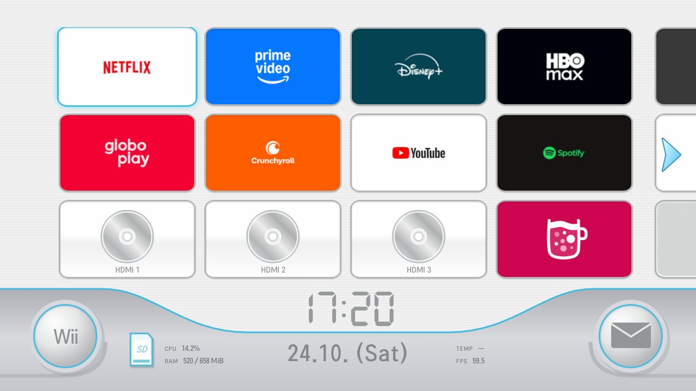

# WiiOS

A Wii-inspired launcher for LG webOS TVs, with customizable channels, application artwork, background music, sound effects, and remote-control navigation.



**Minimum supported version:** webOS TV 4.0. WiiOS has been tested on a physical webOS 4.5 TV. App discovery and Home replacement depend on the firmware.

## Install from an IPK

Use this method to run WiiOS as a regular app without root.

1. Download the standard `com.wiios.launcher_<version>_all.ipk` from [GitHub Releases](https://github.com/KaykCaputo/WiiOS-webOS/releases).
2. On the TV, enable Developer Mode and turn on Key Server. Note the TV's IP address and the passphrase shown on screen. [LG Developer Mode setup](https://webostv.developer.lge.com/develop/getting-started/developer-mode-app)
3. On a computer connected to the same network, add the TV in [webOS Dev Manager](https://github.com/webosbrew/dev-manager-desktop), install the IPK, and open **WiiOS** from the TV's app list.

## Install with the WiiOS Installer

1. Set up [Developer Mode SSH](https://webostv.developer.lge.com/develop/getting-started/developer-mode-app) on your TV. On your computer, install Python 3.10+ and OpenSSH.
2. Download `wiios-installer.pyz` and the standard IPK from the same [GitHub release](https://github.com/KaykCaputo/WiiOS-webOS/releases). Put them in the same folder and open a terminal there.
3. Run the following command. Replace `TV_IP` with the TV's IP address and `VERSION` with the version in your IPK filename.

```sh
python3 ./wiios-installer.pyz tui --text-mode \
  --host TV_IP \
  --transport developer-mode \
  --user prisoner \
  --port 9922 \
  --ipk ./com.wiios.launcher_VERSION_all.ipk
```

4. If prompted, verify the TV's SSH host fingerprint before approving it. Use your configured SSH username and port if they differ from the example.
5. Choose **Install WiiOS as an Application** or **Update WiiOS**. Confirm with `y`, then choose **Launch WiiOS** or open it from the TV's app list.

On a rooted TV, use `--transport root-ssh --user root --port 22` with the same IPK and your configured SSH settings. The installer starts the bundled TV helper for app discovery, artwork, and system stats when the TV supports it.

## Install from Homebrew Channel

The catalog listing is pending. Once it is available, open [Homebrew Channel](https://repo.webosbrew.org/) on the TV, look for **WiiOS** under **Launchers**, select **Install**, then open WiiOS from the TV's app list. Until then, use the IPK steps above.

## Set WiiOS as Home with Home Chooser

1. On a rooted LG TV, restore LG Home and disable any existing Home remaps. Install [Home Chooser](https://repo.webosbrew.org/apps/org.webosbrew.homechooser/) from Homebrew Channel and open it once to finish setup.
2. Install the same WiiOS IPK used for the regular app. Open **Wii Options → Use WiiOS as Home** and confirm in Home Chooser.
3. Press **Home** on the remote to try it. To restore LG Home, open Home Chooser and select the LG Home option you originally used.

Home Chooser requires Homebrew Channel 0.8.0 or later on webOS 11 and newer. WiiOS still needs hardware validation for startup and recovery through this integration.

For the device-specific QML integration, see the [observed compatibility and recovery notes](compatibility/profiles/observed/README.md).

## Restore App Discovery and Artwork

Open **Wii Options → App Library → Refresh Library**. Select an app to assign it to a channel or use **Add Missing Apps to Empty Channels**. WiiOS checks the TV helper and available app listing APIs, including Home Chooser when its catalog permission is available. If Luna is restricted, try **Wii Options → TV Pairing for App Catalog** and confirm the pairing on the TV. Previously discovered apps stay available during service outages.

After a direct IPK or Homebrew Channel installation, run this from a computer with authorized root SSH to activate the bundled helper:

```sh
python3 ./wiios-installer.pyz helper install --host TV_IP --transport root-ssh --user root --port 22
```

The helper supplies CPU, RAM, and temperature when available. WiiOS measures FPS locally.

## Build

```sh
npm ci
npm test
python3 scripts/build.py
```

The build refreshes the IPK, installer, and checksums in `release/`.

GitHub Actions publishes one IPK, the WiiOS Installer, checksums, and the Homebrew Channel manifest. The catalog listing is reviewed separately by the Homebrew Channel maintainers.

## License

Original source is licensed under [Apache License 2.0](LICENSE). Nintendo and LG materials remain the property of their respective owners; see [NOTICE](NOTICE). WiiOS is independent of Nintendo and LG.
