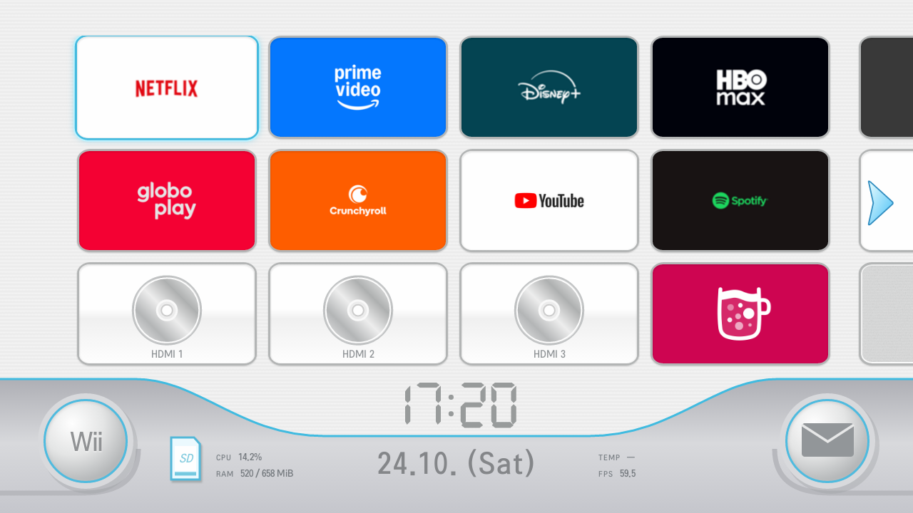
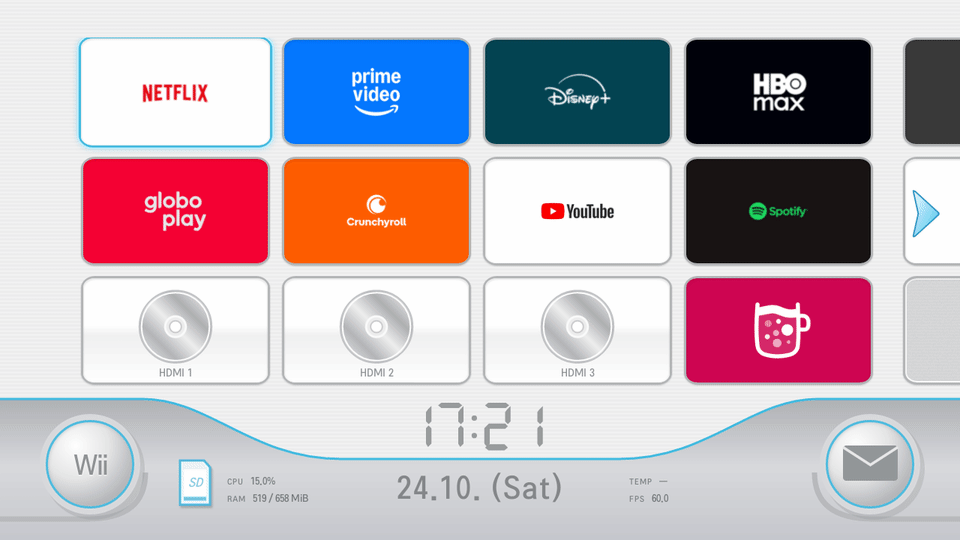

# WiiOS

A Wii-inspired launcher for LG webOS TVs. WiiOS displays installed apps as channels with their original artwork, matching backgrounds, and classic menu sounds.

Tested on **LG LM625BPSB**, **webOS 4.5**, firmware **05.40.97**. Full Home replacement is firmware-specific.


## Preview



### Demo



## Install

For full Home integration, the TV must be rooted, with the Homebrew Channel and root SSH access. Python 3 and Make are required on your computer.

```sh
make install TV=YOUR_TV_IP
```

To update only the app and its required local artwork service:

```sh
make app TV=YOUR_TV_IP
```

To build an IPK without modifying the TV:

```sh
make build
```

The IPK can run as a standalone app without root, but complete app artwork discovery and Home replacement require elevated access. Do not apply the firmware-specific Home integration to untested TVs.

## Commands

`make status`, `make home`, `make home-off`, `make privacy`, `make privacy-off` and `make off` accept `TV=YOUR_TV_IP`. Run `npm ci && make test` for tests.

## License

Original WiiOS source code is licensed under [Apache 2.0](LICENSE). Nintendo Wii trademarks, interface materials, graphics, music and sound effects belong to Nintendo and/or their respective owners and are not covered by the code license. See [NOTICE](NOTICE). WiiOS is not affiliated with Nintendo or LG.
